<div align="center">

# GlassVault

### Every rupee, provable.

**A verifiable donation platform where an NGO can't move donated money without proof — and can't fake the proof.**


CASCADE '26 · Theme 4 · **PS 4.2 — The Black Hole Ledger: Verifiable NGO Fund Flows**

**[▶ Live platform](https://fly-feed-singles-three.trycloudflare.com)** · 

<sub>Hosted from the team laptop through a Cloudflare tunnel — online during the event; if the link is down, run it locally in two commands (see Getting started).</sub>

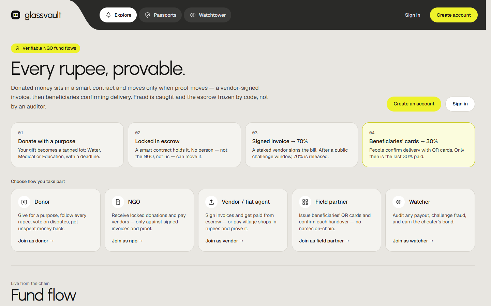

</div>

---

## Contents

[The problem](#the-problem) · [What GlassVault does](#what-glassvault-does) · [How a rupee moves](#how-a-rupee-moves) · [Architecture](#architecture) · [Blockchain stack — and why](#blockchain-stack--and-why) · [Fraud detection](#fraud-detection-without-a-central-auditor) · [Verify it yourself](#verify-it-yourself--no-trust-in-glassvault) · [Probabilistic evaluation chain](#probabilistic-evaluation-chain) · [Roles](#roles) · [Screens](#screens) · [Quality](#quality-and-proof) · [Getting started](#getting-started) · [Repository layout](#repository-layout) · [Security](#security-and-honest-limitations) · [Roadmap](#roadmap)

## The problem

Donors send money to NGOs and then have to trust the NGO's own report of what happened to it.
Transactions, expense receipts and impact reports live in separate places, so nobody can check
that a rupee earmarked for water was actually spent on water — and an adversarial NGO can show
the same receipt to several donors or simply invent receipts.

## What GlassVault does

Donated money never reaches the NGO's wallet. It sits in a **smart-contract escrow** and moves only
when **proof moves**:

| Gate | Proof the contract demands | Problem-statement requirement |
|---|---|---|
| **① Inbound donation** | A tagged lot: donor, NGO, purpose, deadline, source chain. ETH paid on another chain is swapped and bridged without losing the tag. | Purpose-bound allocation · multi-hop flows |
| **② Escrow condition** | Category and budget must match, a public challenge window must pass, deadlines are enforced. No admin key exists. | Purpose-bound allocation |
| **③ Off-chain invoice proof** | The vendor's EIP-712 signature over the exact invoice fields + the receipt file's hash. A global nullifier stops any invoice — or bank transfer — being used twice. | Verifiable expenditure records · double counting · forged receipts |
| **④ Cryptographic impact verification** | Beneficiaries' QR cards **sign** the delivery; the contract checks a Merkle proof against a card list attested by an independent field partner. No identity goes on-chain. Only then is the last 30% paid. | Privacy protection |

Fraud attempts are **recorded on-chain**, and two of them **freeze the NGO automatically** — no
auditor, no admin, no human pressing a button. Whoever proves fraud is paid the cheater's bond.

> **Money moves only when proof moves.** Proof can't be forged without the vendor's key, can't be
> reused because of nullifiers, and can't expose beneficiaries because only fingerprints go on-chain.

## How a rupee moves

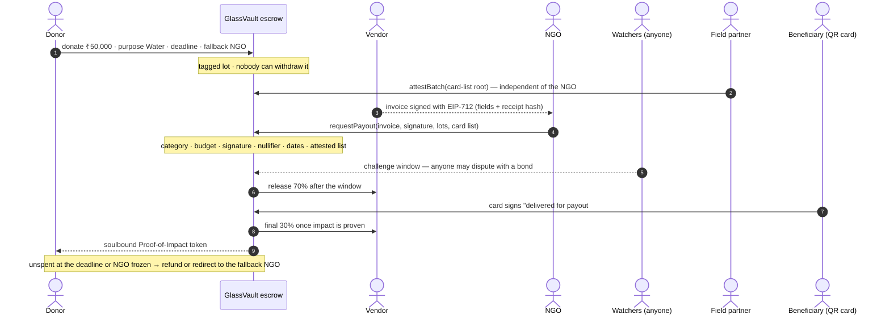

## Architecture

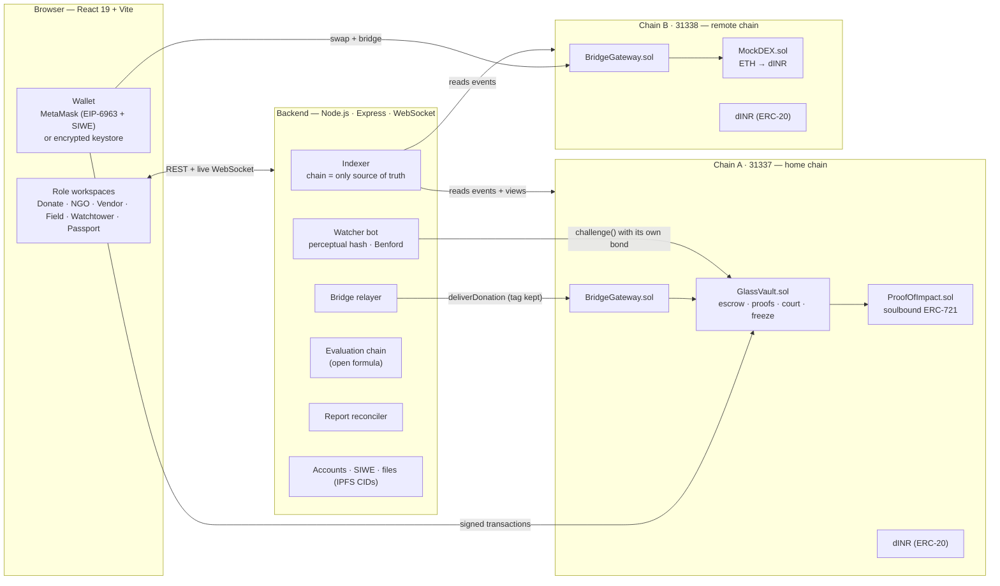

**Design rules**

1. **The chain is the only source of truth.** The backend indexes, stores files, relays and files challenges — it never decides fraud and cannot move money.
2. **No admin key.** Freezes, refunds, payouts and slashing happen only through contract rules (verified: the ABI has no owner, pause, withdraw or unfreeze function).
3. **Fraud attempts are recorded, not just rejected**, so they count toward the automatic freeze.
4. **No personal data on-chain** — hashes, nullifiers, Merkle roots and signatures only.
5. **Watchers have no special power.** The bot uses the same public `challenge()` any citizen can, with its own bond.

Deep dive: [docs/ARCHITECTURE.md](docs/ARCHITECTURE.md) — payout state machine, escrow invariant, trust boundaries.

## Blockchain stack — and why

| Layer | Choice | Why this, for this problem |
|---|---|---|
| Smart contracts | **Solidity 0.8.28** + **OpenZeppelin 5** (`EIP712`, `ECDSA`, `MerkleProof`, `ReentrancyGuard`, `SafeERC20`, `ERC721`) | Audited building blocks for exactly the primitives we need — typed signatures, Merkle proofs, reentrancy guards — instead of hand-written cryptography. Checked arithmetic by default. |
| Escrow currency | **dINR** — rupee stablecoin (ERC-20) | Donors think in rupees; a stablecoin keeps ₹50,000 meaning ₹50,000. Volatile assets (ETH) enter through the swap hop. |
| Invoice proof | **EIP-712 typed signatures** (as in Uniswap Permit) | The vendor signs human-readable fields; editing one digit breaks the signature on-chain. |
| Double-spend of evidence | **Nullifiers** (as in Zcash / Semaphore) | `keccak(vendor, invoiceNo, date, amount)` and hashed bank references are global, so the same evidence can't back two payouts, for any NGO or donor. |
| Beneficiary privacy | **Merkle proofs** (as in Uniswap airdrops) + **card-held keys** | Proves "this card is on the approved list" without publishing the list; the card signs the delivery, so its key never touches the chain. |
| Auditor-free enforcement | **Optimistic challenge window** (as in Optimism / UMA) + **bonds and slashing** (as in proof-of-stake) | Payouts wait in public; anyone can challenge with a bond; the funding donors decide; whoever is right is paid from the cheater's stake. |
| Multi-chain | **Two EVM chains**, `BridgeGateway` lock-and-deliver, `MockDEX` swap | The PS example — *swapped, bridged, spent off-chain* — runs for real; the donation's tag survives every hop and is rebuilt from events alone. |
| Off-chain fiat | **Signed `FiatSettlement`** from a staked payment agent | The chain can't see a bank account, so the agent's stake and a single-use bank reference make lying expensive and detectable. |
| Impact certificate | **Soulbound ERC-721** (`ProofOfImpact`) | "My rupees did this" as a non-transferable token minted only when impact is proven. |
| Wallets | **MetaMask** via **EIP-6963** discovery + **Sign-In with Ethereum (EIP-4361)**, or a browser-encrypted **keystore (Web3 Secret Storage)** | Users bring their own wallet, or get one created in the browser — the server never holds a private key. |
| Client library | **ethers v6** | Typed-data signing, ABI coding and providers for both chains with one library. |
| Files | **IPFS-format content IDs** (sha-256, raw codec) | Receipts are addressed by their own hash — the same hash the vendor signed. |
| Toolchain | **Hardhat 2** (two local nodes), Chai, Playwright | Instant, deterministic chains for tests, the benchmark and the live demo. |

## Fraud detection without a central auditor

| Attack | Caught by | Result |
|---|---|---|
| Same invoice in several donor reports / NGOs (re-scanned too) | Global invoice nullifier | Fraud flag |
| Forged receipt, or amount edited after signing | EIP-712 vendor signature | Fraud flag |
| Invoice from a fake vendor | Staked vendor registry | Fraud flag |
| Spending outside the declared category | Escrow rule | Fraud flag |
| Invoice dated in the future | Timeline rule | Fraud flag |
| Same receipt photo re-billed under a new number (colluding vendor) | Watcher bot's 256-bit perceptual hash → bonded `challenge()` | Funding donors vote; upheld → payout cancelled, NGO bond + vendor stake to the challenger |
| Vendor signs the same invoice for two NGOs | Nullifier + signature check | Vendor slashed and banned; honest NGO not blamed |
| Same bank transfer used to prove two fiat payouts | Bank-reference nullifier | Agent slashed; unpaid 30% back to donors |
| Released to a fiat agent but never proven paid in rupees | `flagUnsettled()` — anyone, after the deadline | Agent stake to the reporter; NGO flagged; unpaid 30% back |
| Published report ≠ ledger; one invoice told to many donors | Report Reconciler | Over-claims, over-attribution and double counting, line by line |
| Money in escrow that no rule explains | Escrow ledger invariant | Any gap shown publicly (it is ₹0) |
| Over budget / invoice long before the donation / impact never proven | Escrow and timeline rules, `expireImpact()` | Recorded discrepancy; money returned; not counted toward a freeze |

**Two fraud flags → the contract freezes the NGO** in the same transaction. Pending payouts unwind
and donors reclaim every unpaid rupee — or anyone pulls the **dead-man switch** to move it to the
donor's fallback NGO.

## Verify it yourself — no trust in GlassVault

The PS starts from donors having *no independently verifiable way* to check. The **Verify** page (`/verify`, public, no login) is that way:

- **Drop a receipt** → your browser hashes it (keccak-256) and asks the contract which payout committed that fingerprint: status, amount, vendor, deliveries, nullifier, fraud flags.
- **A re-scanned copy** (new hash) is still recognised: committed receipt files are fetched, **re-hashed in the browser and checked against the contract**, then compared by image fingerprint (dHash) locally. A lying server could hide a file, never fake one.
- **Audit a payout** → its full event history (blocks, transactions) from the chain's event log.
- **NGO status** → frozen / flags / trust, straight from contract storage.

Every verdict comes from the blockchain node, read by the visitor's browser — GlassVault's database, indexer and API are not consulted. Tested by `e2e/verify.js` and act 15 of the judges' drill.


## Probabilistic evaluation chain

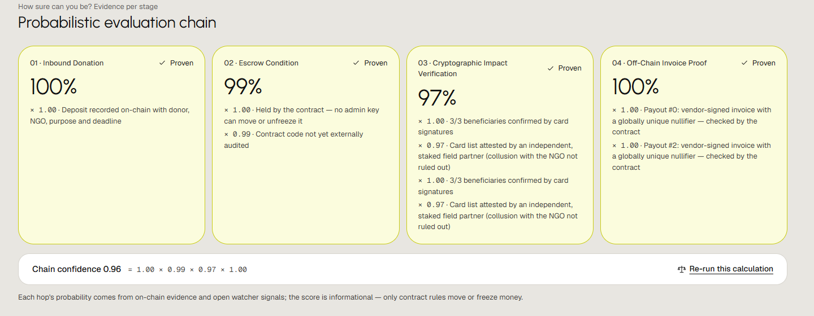

Every donation is scored per stage in the PS order — **Inbound → Escrow → Cryptographic Impact
Verification → Off-Chain Invoice Proof**. Each stage starts at 1 and is multiplied by named evidence
factors (e.g. *single bridge relayer ×0.97*, *field-partner collusion not ruled out ×0.97*, *watcher
near-duplicate ×0.4*, *upheld fraud ×0*); chain confidence is the product. The formula is open and
deterministic ([`backend/src/confidence.js`](backend/src/confidence.js)): `GET /api/confidence/:lotId`
shows every factor and `npm run confidence` re-runs it from public state. It is informational — only
contract rules move or freeze money.

## Roles

| Role | Does | Workspace |
|---|---|---|
| **Donor** | Gives for a purpose (rupees, or ETH from another chain), follows every rupee, votes on disputes, reclaims or redirects unspent money, receives Proof-of-Impact tokens | Donate · My donations |
| **NGO** | Posts a ₹10,000 bond, pays vendors only against signed invoices and attested card lists, releases payouts | NGO console |
| **Vendor** | Stakes ₹5,000, signs invoices with the receipt attached, gets paid from escrow | Invoices |
| **Fiat payment agent** | Pays local cash/bank-only shops in rupees and proves it with a signed settlement | Invoices → settle in rupees |
| **Field partner** | Stakes ₹2,000, issues QR cards in the browser, vouches for card lists, confirms handovers | Deliveries |
| **Watcher** | Challenges payouts, flags unexplained transfers, unlocks stuck money, reconciles reports, runs the red team | Watchtower |
| **Public** | Sees every flow, passport and trust score without an account | Explore · Passports |

Every signed-in role gets a **guided tour** written for that role (and its current state) on first
login, and a "Next for you" strip listing exactly what needs them now.

## Screens

| | |
|---|---|
| 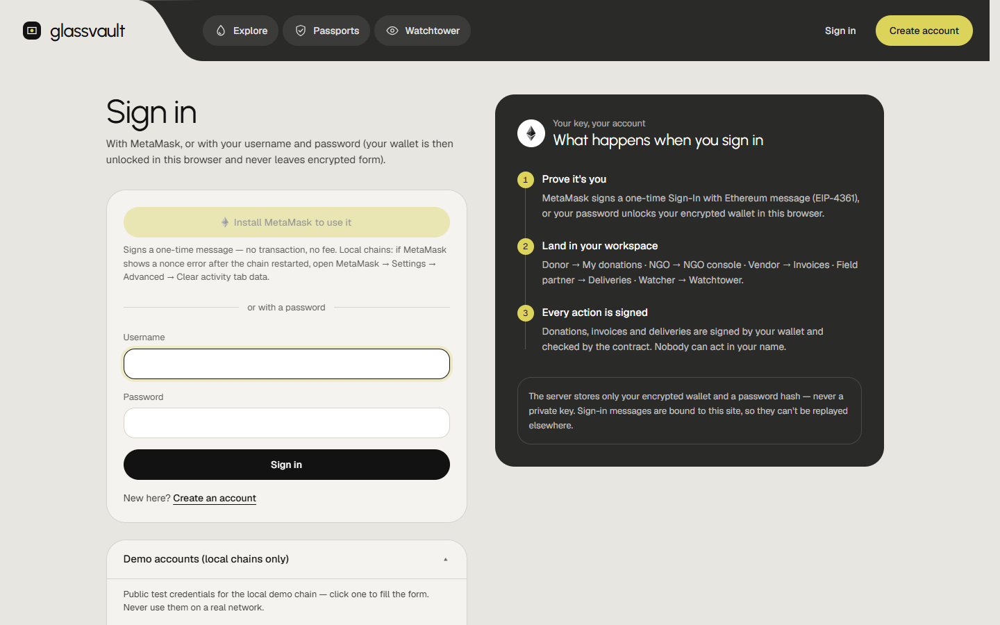<br/>**Sign in** — MetaMask (Sign-In with Ethereum) or a password wallet; demo accounts by role | <br/>**How a rupee moves** — four steps, live numbers from the chain |
| 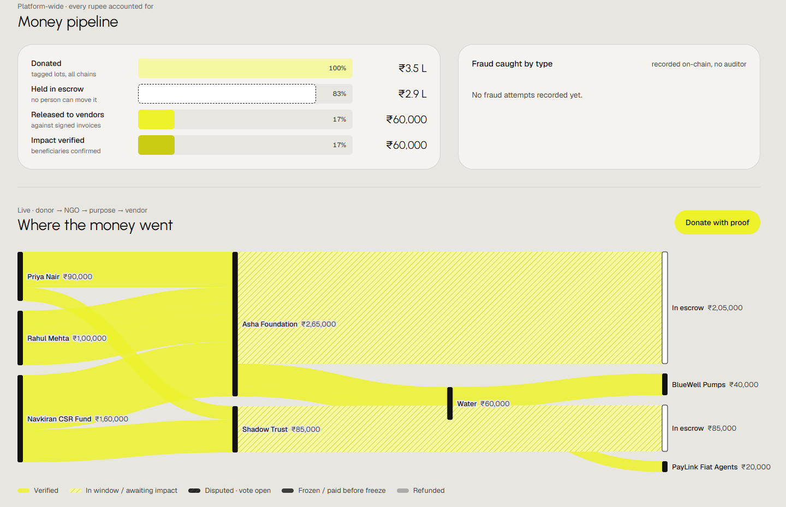<br/>**Live fund flow** — money pipeline and Sankey from donor to vendor | 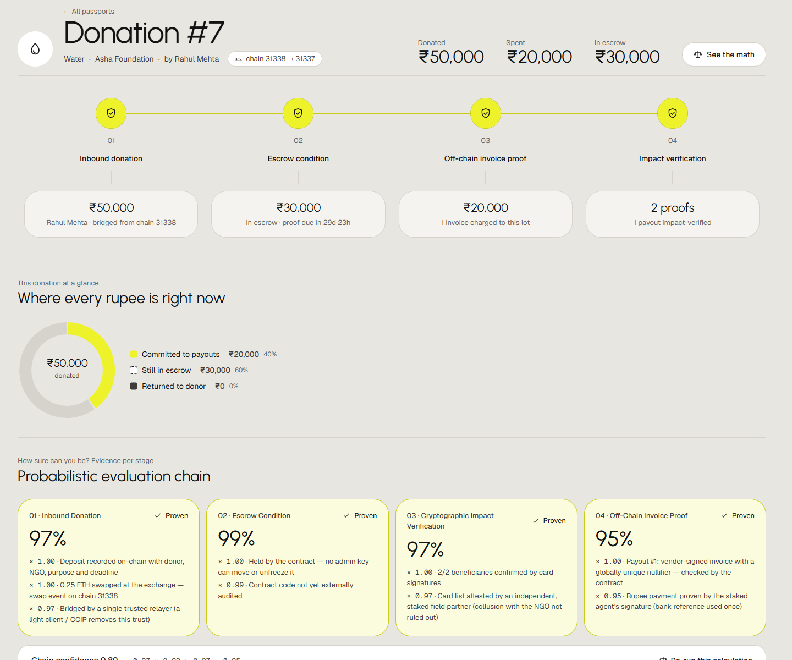<br/>**Multi-hop journey** — ETH → swap → bridge → fiat agent → rupees |
| 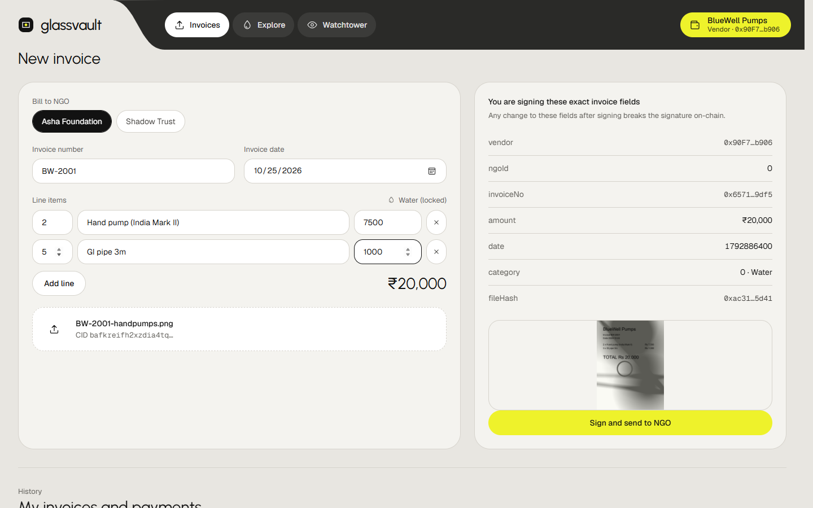<br/>**Vendor** signs the exact fields + receipt hash | 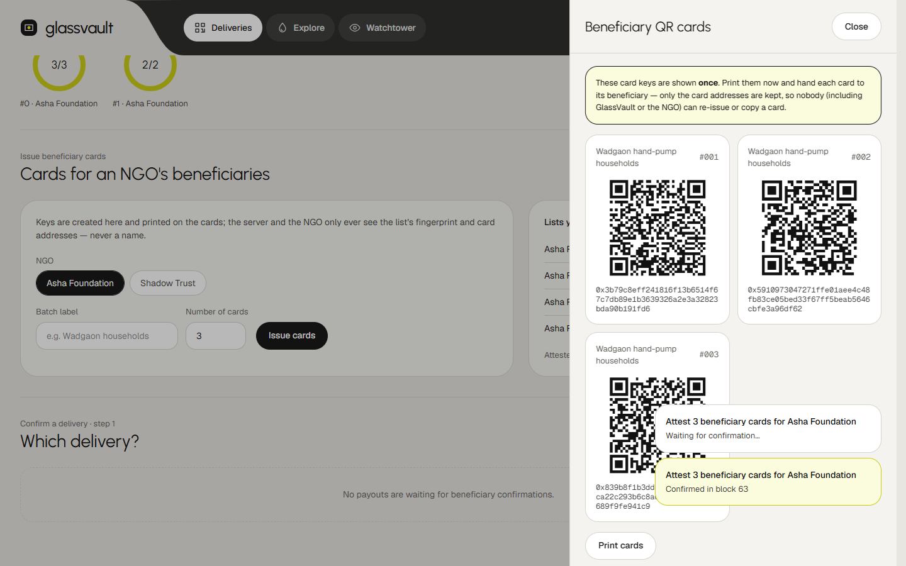<br/>**Field partner** issues QR cards — keys never leave the card |
| 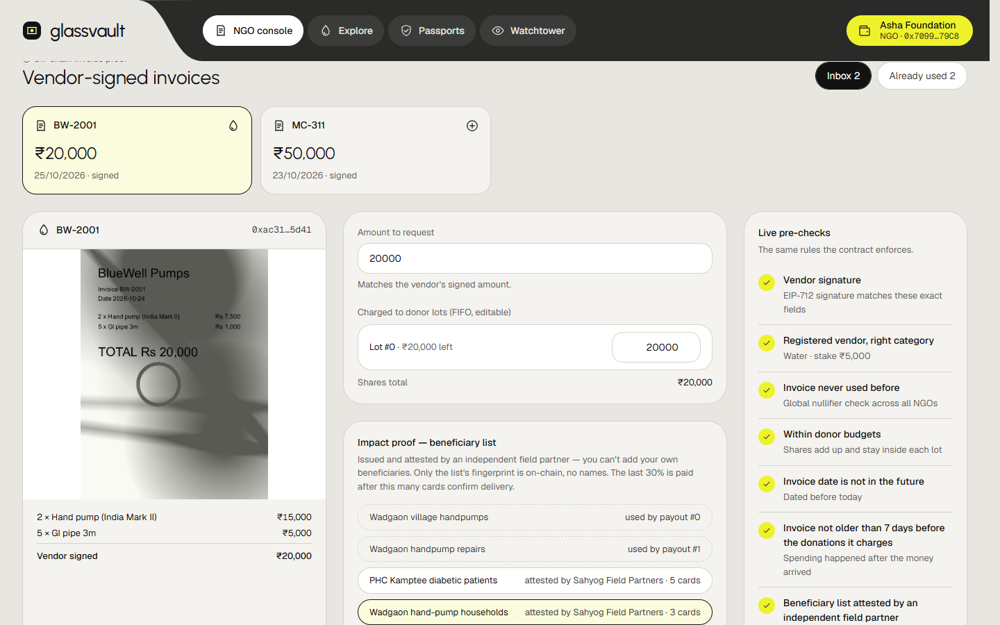<br/>**NGO** pays only after every pre-check passes | 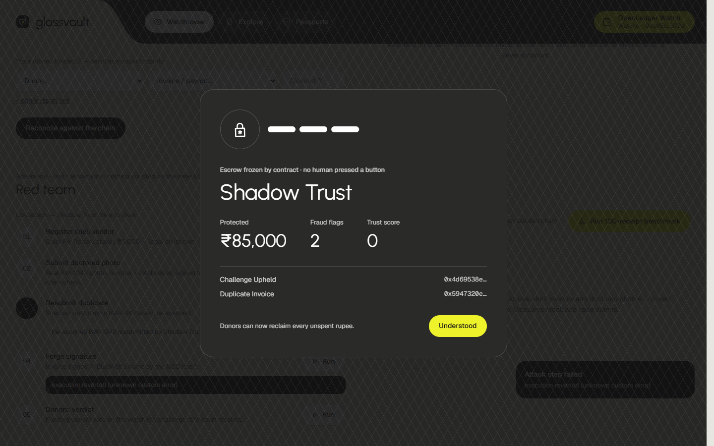<br/>**Automatic freeze** — no human pressed a button |
| 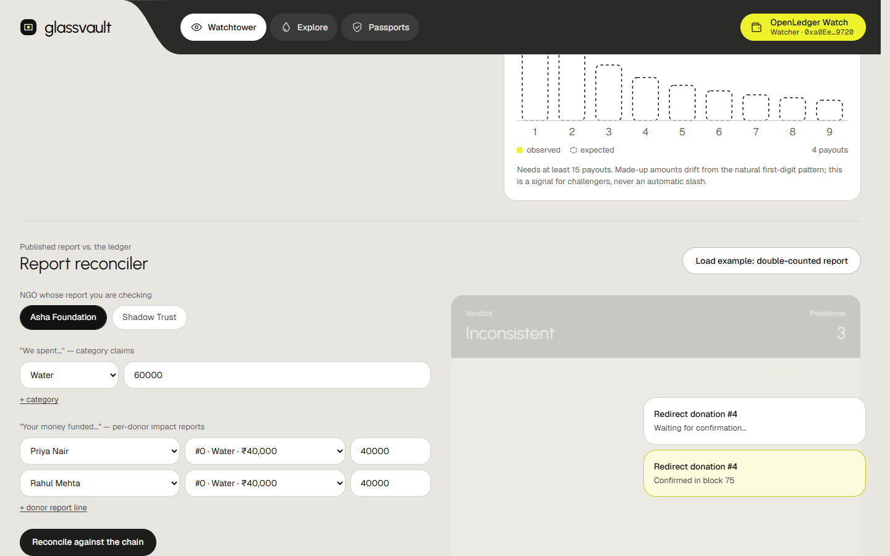<br/>**Report Reconciler** — published claims vs the chain | 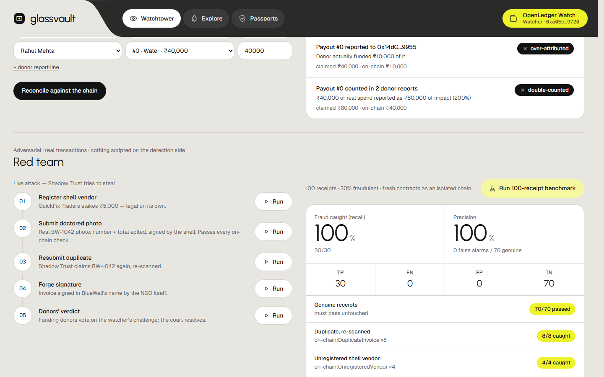<br/>**Benchmark** — 100 receipts, 30% forged |
| 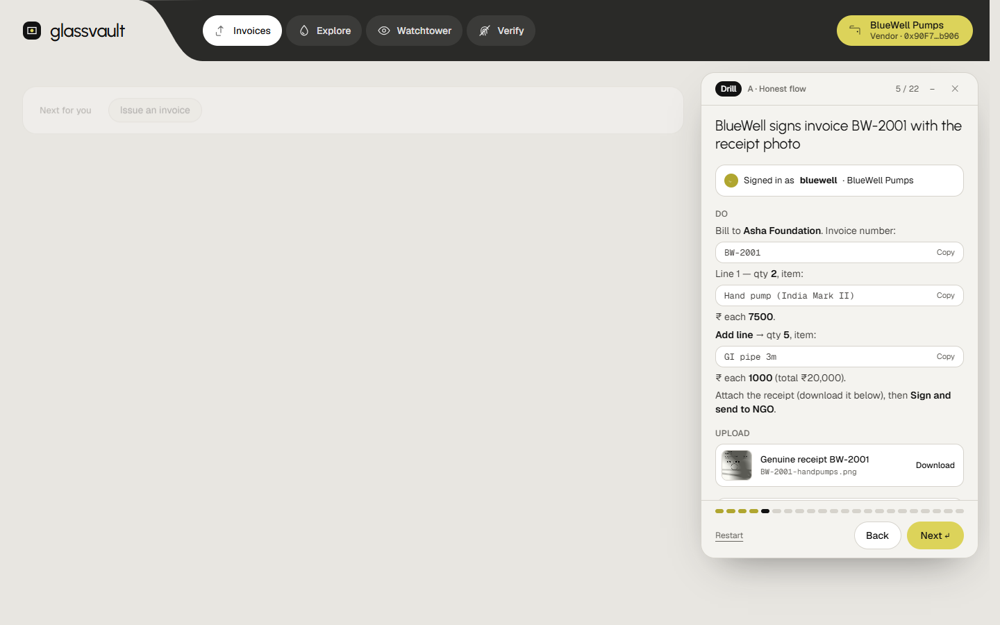<br/>**In-app Drill** — every role, every upload, ticked off from the chain | <br/>**Verify it yourself** — browser ↔ chain, no server trust |
| 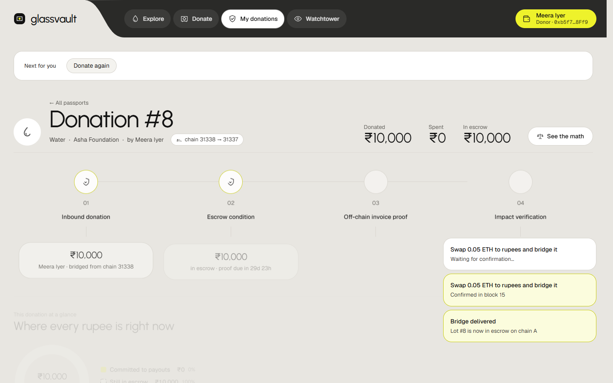<br/>**MetaMask** donor gives ETH on chain B | 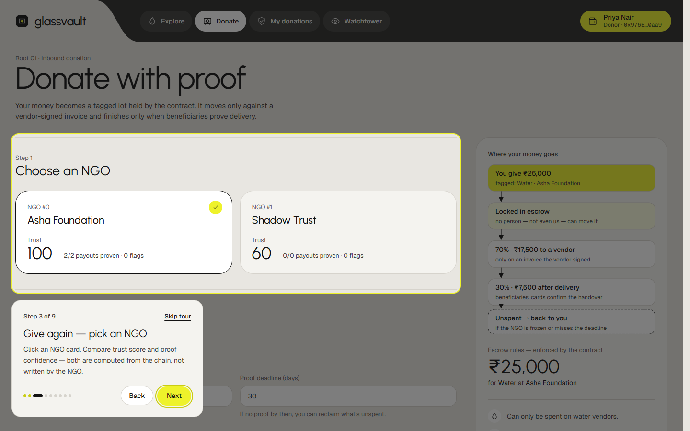<br/>**Guided tour** per role |

## Quality and proof

| Check | Result | Command |
|---|---|---|
| Contract tests — happy paths, every attack, security regressions | **64 / 64** | `npm test` |
| Problem-statement acceptance suite — each PS 4.2 requirement on real contract execution | **12 / 12** | `npm run acceptance` |
| Red-team benchmark — 100 receipts, 30% fraudulent | **30 / 30 caught · 0 / 70 false alarms** | `npm run benchmark` |
| End-to-end browser suites on an isolated production build (smoke, tours, evaluation chain, Sign-In with Ethereum, MetaMask journey, sign-up, multi-hop, flow, red-team, performance) | **all passing** | `npm run e2e:full` |
| Judges' demo — 15 acts, every role, every PS requirement | **9 / 9 requirements covered** | `npm run demo:rehearse` |
| **Live drill through the public link** (26 Oct 2026) — the judges' sequence, all roles, plus every e2e suite against the hosted URL | **15 / 15 steps · all suites pass** | [docs/DRILL-REPORT.md](docs/DRILL-REPORT.md) |
| **In-app Drill** — the judges' drill performed through its own panel (22 steps, every role, uploads, card keys) | **22 / 22 · detected on-chain** | `npm run demo:drill` |
| Escrow invariant — vault balance = lots + reserved + bonds + stakes + challenge bonds | **gap ₹0** | live in Watchtower |
| UI responsiveness — page switch / scroll lag | **~115 ms / 0 ms** (from 1.5 s / 720 ms) | `npm run perf` |
| Independent security review | 2 high + 4 medium found → **all fixed with regression tests** | see [SECURITY.md](SECURITY.md) |

`npm run check` (tests + acceptance + lint + build) gates every change and runs in CI.

## Getting started

**Requires** Node.js ≥ 22.5 (for `node:sqlite`). The browser tests drive Microsoft Edge via Playwright.

```bash
git clone https://github.com/shriomverma100/GlassVault.git
cd GlassVault
npm run install:all       # contracts, backend, frontend
npm run start:prod        # 2 chains → deploy → backend → seeded history → http://localhost:5173
```

Sign in with a demo account (local chains only — the **Sign in** page lists them with one-click fill),
or create your own account with a password or **MetaMask**. The judges' walkthrough is in
[demo/DEMO-RUNBOOK.md](demo/DEMO-RUNBOOK.md); the step-by-step drill with the reason for every step is
[demo/JUDGES-DRILL.md](demo/JUDGES-DRILL.md) — and the same drill is built into the app: the yellow **Drill** button (above **Tour**) walks every role, switches accounts in one click, offers the upload files and ticks each step off when the chain confirms it, and the drill results are in [docs/DRILL-REPORT.md](docs/DRILL-REPORT.md).

| Command | What it does |
|---|---|
| `npm start` / `npm run start:prod` | Whole platform from scratch — dev server / production build |
| `npm run stop` | Stop a running platform (add `-- --profile=test` for the isolated test stack) |
| `npm test` | 64 contract tests |
| `npm run acceptance` | PS 4.2 acceptance suite (includes the benchmark) |
| `npm run benchmark` | 100-receipt red-team benchmark on an isolated chain |
| `npm run check` | Tests + acceptance + lint + production build |
| `npm run e2e:full` | Every browser suite on a fresh isolated stack (ports +10000), always torn down |
| `npm run confidence` | Re-run the evaluation chain from public state and verify every published score |
| `npm run demo:kit` / `npm run demo:rehearse` | Upload kit for the demo / replay all 14 demo acts |
| `npm run perf` | UI responsiveness probe vs `e2e/perf-baseline.json` |

<details>
<summary><b>Demo accounts</b> (public, local test chains only)</summary>

| Role | Username | Password |
|---|---|---|
| Donor | `priya` | `Priya@Donor26` |
| Donor | `rahul` | `Rahul@Donor26` |
| Donor (CSR fund) | `navkiran` | `Navkiran@CSR26` |
| NGO | `asha` | `Asha@NGO2026` |
| NGO (adversarial) | `shadow` | `Shadow@NGO2026` |
| Vendor | `bluewell` / `medicare` / `vidya` | `BlueWell@Vendor26` / `Medilink@Vendor26` / `Vidya@Vendor26` |
| Vendor (shell) | `quickfix` | `QuickFix@Vendor26` |
| Fiat agent | `paylink` | `PayLink@Agent26` |
| Field partner | `field` | `Sahyog@Field26` |
| Watcher | `watcher` | `Watch@Tower26` |

These wallets are Hardhat development keys and these passwords are published here — never reuse either outside the local chains.
</details>

## Repository layout

```
contracts/          Solidity 0.8.28 · Hardhat · OpenZeppelin 5
  contracts/        GlassVault · BridgeGateway · MockDEX · ProofOfImpact · DINR
  test/             64 tests (escrow, court, off-ramp, privacy, timelines, security regressions)
  scripts/          deploy · benchmark · acceptance (PS 4.2 matrix)
backend/            Node.js (ESM) · Express · WebSocket · node:sqlite
  src/              indexer · watcher · relayer · reconciler · confidence · accounts/auth · files
  scripts/          seed (real on-chain history) · red-team attack · demo accounts
frontend/           React 19 · Vite 8 · Tailwind v4 · Framer Motion · D3
  src/pages/        Explore · Donate · Passport · NGO · Vendor · Field · Watchtower · Login · Signup
  src/components/   tour · charts (viz) · journey · evaluation chain · watchtower panels
  src/lib/          store · chain (ethers) · metamask (EIP-6963, SIWE) · wallet (keystore) · format
e2e/                Playwright suites · demo rehearsal · MetaMask-compatible wallet mock
demo/               judges' runbook · upload kit · act screenshots
docs/               architecture deep dive · README images
scripts/            dev runner (profiles, prod build) · e2e harness · stop
```

## Security and honest limitations

The contracts and auth layer were independently reviewed; every finding was fixed and pinned with a
regression test. The security model, the review and the known limitations — trusted bridge relayer,
fiat-agent trust, field-partner collusion, sybil voting, unaudited contracts — are written down in
**[SECURITY.md](SECURITY.md)**. This is a hackathon build on local chains, not audited software.

## Roadmap

- **Public testnets** — Sepolia + Base Sepolia, verified contracts, Hardhat Ignition deploys
- **Trust-minimised bridge** — Chainlink CCIP or a light client instead of a single relayer
- **Real swaps and storage** — a Uniswap pool for the swap hop; Pinata / web3.storage pinning
- **Stronger privacy** — zero-knowledge membership proofs (Semaphore) for reusable, unlinkable cards
- **Fiat proof without trust** — bank / UPI webhook signatures or zkTLS proofs of the bank statement
- **Governance hardening** — per-lot donor veto against sybil votes, bond/stake withdrawal with cooldown, external audit

## License

[MIT](LICENSE) — the same licence declared in every contract's SPDX header.
