# GlassVault — Judges' Drill (step by step, with reasons)

Tested end-to-end through the public link on 26 Oct 2026: **all 15 steps passed, all 9 PS requirements covered** (report: [docs/DRILL-REPORT.md](../docs/DRILL-REPORT.md)).

**Live link:** https://fly-feed-singles-three.trycloudflare.com  
**Repo:** https://github.com/shriomverma100/GlassVault

## The story you are telling
> A donor gives money earmarked for **water**. It is swapped, bridged and finally spent in rupees by a village vendor. Every hop is traced, every rupee is tied to a signed receipt, beneficiaries prove delivery without revealing who they are — and when a cheating NGO reuses one receipt and forges others, the contract freezes it by itself.

Steps 1–9 = the honest water project. Steps 10–14 = the attack and how the system defeats it. Step 15 = anyone verifies it all themselves, straight from the chain.

## What is in this folder
| Folder / file | What it is | Used in |
|---|---|---|
| `DRILL-GUIDE.html` | This guide with screenshots — open it in a browser | whole drill |
| `kit/BW-2001-handpumps.png` | the genuine receipt photo | Step 4 |
| `kit/BW-2001-rescan-as-BW-2077.png` | the same photo re-scanned + re-numbered (the fraud) | Step 10 |
| `kit/VB-310-textbooks.png` | a 2nd genuine receipt (Education, Vidya Books) | optional |
| `card-keys.txt` | paste the 3 card keys from Step 5 here | Steps 5, 8 |
| `invoice-details.txt` | copy-paste values for the invoices | Steps 4, 10 |
| `demo/shots/` | what each step should look like (from the tested run) | compare live |
| `workspace-views/` | every page of every role (from the automated tests) | backup slides |
| `test-evidence/` | logs of every test run through the public link | proof for judges |

## The fastest way: the Drill button in the app
Click the yellow **Drill** button (bottom-right, just above **Tour**). A panel docks on the right and walks you through all 22 steps of this guide:
- **Sign in as …** — one click switches to the right role for each step.
- **Do** — exactly what to click, with **Copy** buttons for every value (invoice numbers, item names, labels, amounts).
- **Upload** — the receipt files, downloadable right from the panel.
- **Card keys** — captured when the field partner issues the cards, offered back with Copy at the delivery step.
- **Done — detected on the chain** — each step ticks itself off when the contract confirms it.
- **Enter** or → = next · ← = back · Esc = close (your place is kept, even across reloads). The panel steps aside while a drawer, the freeze screen or the unlock prompt is open.

Tested: the whole drill performed through the panel, 22 / 22 (`npm run demo:drill`). See `demo/shots/drill-panel-*.png`.


## Step 0 — before the judges arrive (5 min)
1. **Reset the platform** (fresh chains, fresh data) — in a terminal in `glassvault`:
   ```
   npm run stop
   npm run start:prod
   ```
   Wait for *GlassVault is live → http://localhost:5173*. **Why:** a fresh chain means donation/payout numbers match this guide and no earlier test has frozen Shadow Trust yet.
2. **Public link** — keep the `npm run share` window open (or start it: `npm run share`, it prints a new link). **Why:** judges can open the platform on their own phones/laptops.
3. **Sign-in page** (see `docs/images/sign-in.png`): left = **Continue with MetaMask** + username/password, with **Demo accounts grouped by role** underneath — click a row (it fills the form and turns yellow), then **Sign in**. Right = "What happens when you sign in" (3 steps). **Why:** judges see at once how identity works: a wallet signature, never a stored key.
4. **Browser:** one window per role at the same time = use separate browser profiles or incognito windows (each keeps its own login), or sign out/in between steps.
5. **Zoom 90%** on a projector. Keep a terminal open for Step 14.
6. **When the app asks "Unlock your wallet to sign"** → type the same password → **Unlock and continue**. **Why:** the wallet key is stored encrypted in the browser; the server never sees it.

## Logins (public demo credentials, local test chains only)
| Role | Username | Password | Who |
|---|---|---|---|
| Donor | `priya` | `Priya@Donor26` | Priya Nair — gives ₹25,000 for Water (Step 3) |
| Donor | `rahul` | `Rahul@Donor26` | Rahul Mehta — his 0.25 ETH went swap → bridge → fiat (Step 9) |
| Donor | `navkiran` | `Navkiran@CSR26` | Navkiran CSR Fund — funded Shadow Trust, votes in court (Step 11) |
| NGO | `asha` | `Asha@NGO2026` | Asha Foundation — the honest NGO |
| NGO | `shadow` | `Shadow@NGO2026` | Shadow Trust — the cheating NGO |
| Vendor | `bluewell` | `BlueWell@Vendor26` | BlueWell Pumps — Water supplier |
| Vendor | `medicare` | `Medilink@Vendor26` | Medilink Supplies — Medical supplier (not needed in drill) |
| Vendor | `vidya` | `Vidya@Vendor26` | Vidya Books — Education supplier (optional) |
| Vendor | `quickfix` | `QuickFix@Vendor26` | QuickFix Traders — shell vendor (red team) |
| Fiat agent | `paylink` | `PayLink@Agent26` | PayLink — pays village shops in rupees (Step 9) |
| Field partner | `field` | `Sahyog@Field26` | Sahyog Field Partners — issues & scans QR cards |
| Watcher | `watcher` | `Watch@Tower26` | OpenLedger Watch — audits, red team, benchmark |
| Donor (MetaMask) | — | — | created live in Step 2 |

---
## Step 1 — The public picture — before anyone logs in

*Story:* A judge (or any donor) opens the site with no account.

**Login:** Nobody (signed out) · **Page:** Home page `/`

**Do:**
1. Open the public link.
2. Point at the **flow diagram** in the first panel: 01 Donate → 02 Locked in escrow → 03 Signed invoice → 70% → 04 Beneficiaries' cards → 30%. Each step shows a **live number** from the chain; yellow dots show money moving along the lines; the watcher line drops into the challenge window.
3. Point at the **Built on** strip: Ethereum (EVM), Solidity, OpenZeppelin, EIP-712, Sign-In with Ethereum, MetaMask.
4. Hover a role card (its border and shadow respond, the arrow slides), then scroll: live ticker → money pipeline → Sankey flow chart → NGO cards.

**You should see:** The four-step flow with live totals (donated, in escrow, paid to vendors, deliveries proven), the five roles, a pipeline of where money is right now, and each NGO's trust and proof-confidence score.

**Why this step:** Transparency must not need a login. Anyone can audit the whole ledger. This shows the problem statement's core promise before a single click: the money is visible, the NGO cannot hide it.

**Say to the judges:** “Donated money never touches the NGO's wallet. It sits in a contract and moves only when proof moves.”

**PS point:** Transparency (context of the PS)

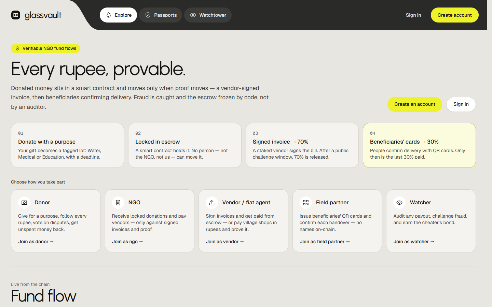

---
## Step 2 — The 50 ETH case (demo scale) — donor pays in ETH, it is swapped and bridged

*Story:* Meera, a crypto donor, gives ETH earmarked for Water. The PS example is 50 ETH; we use 0.05 ETH so the demo chain stays realistic. The mechanism is identical.

**Login:** New donor with MetaMask · **Page:** Sign in → Continue with MetaMask

**Do:**
1. Click **Sign in** → **Continue with MetaMask**.
2. MetaMask asks to **add the GlassVault chain** → Approve. Then it asks to **sign a message** → Sign (free, no transaction).
3. Sign-up page opens: choose **Donor**, name `Meera Iyer`, any username → **Create donor account**.
4. Go to **Donate** → pick **Asha Foundation** → **Water**.
5. Choose **Chain B · via bridge** and **Pay in ETH · swapped**. Amount `0.05`.
6. Wait until it says *Swaps to about ₹10,000* → **Swap, bridge and donate** → confirm in MetaMask.

**You should see:** You land on the donation's Passport. Its journey shows: ETH → swapped to ₹10,000 at the exchange → bridged to chain B → locked as a donation that still remembers Meera and *Water*.

**Why this step:** The PS says funds are *swapped, bridged* and still must be traceable. Every hop carries the same donation id, so the system reconstructs one timeline across two chains. The purpose tag survives the hops, so the money stays earmarked.

**Say to the judges:** “One transaction swaps ETH into rupees and locks it in the bridge; the relayer delivers it on the other chain as a donation that still knows me and the purpose.”

**PS point:** Purpose-bound allocation · Multi-hop: swap + bridge

> No MetaMask on this laptop? Skip this step — Step 9 shows the same swap → bridge → fiat path on a seeded donation.

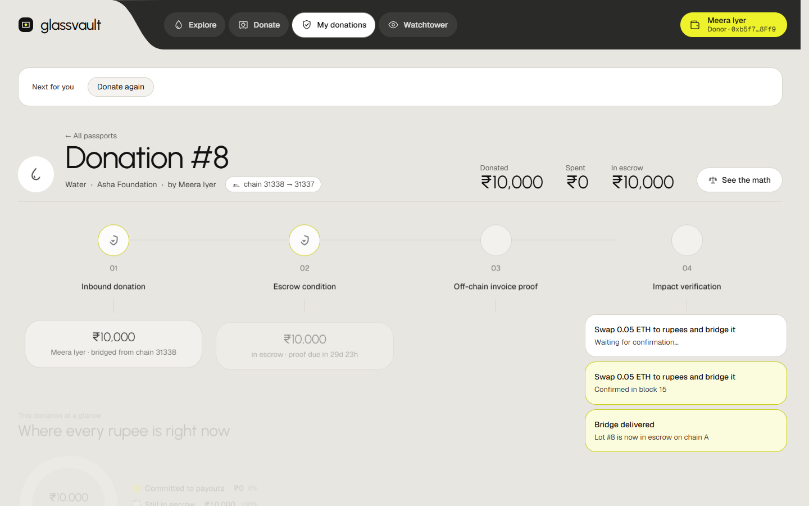

---
## Step 3 — Priya donates ₹25,000 for Water — with a fallback NGO

*Story:* Priya, a normal donor (no crypto knowledge), gives to Asha Foundation's water project.

**Login:** `priya` / `Priya@Donor26` · **Page:** Donate

**Do:**
1. Sign in as priya (Sign-in page → *Demo accounts* → click Priya's row → **Sign in**).
2. **Donate** → **Asha Foundation** → **Water** → amount `25000`.
3. Click **Send it to another NGO** → choose **Shadow Trust** as the fallback.
4. Click **Donate**. If asked *Unlock your wallet to sign*, type the same password → **Unlock and continue**.

**You should see:** Passport for the new donation: *Locked in escrow · Water*. The money is in the contract, not with Asha.

**Why this step:** **Purpose-bound allocation**: the smart contract stores the earmark. Asha can only ever spend this on Water invoices. The fallback is a *dead-man switch*: if Asha never proves impact, or gets frozen, the money moves to the fallback instead of being stuck or kept.

**Say to the judges:** “My gift is earmarked Water. If Asha fails, it moves to my fallback — nobody can keep it.”

**PS point:** Purpose-bound allocation

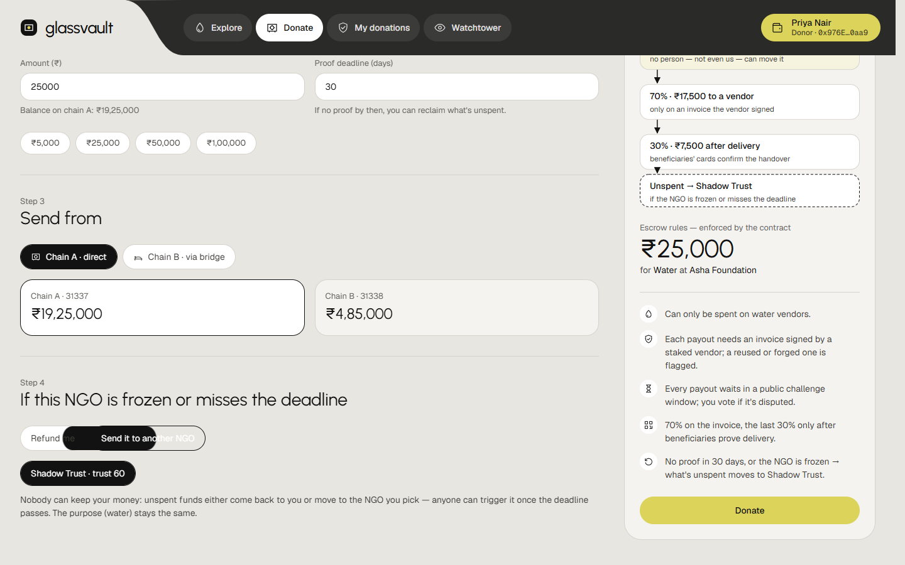

---
## Step 4 — Vendor BlueWell signs invoice BW-2001 and attaches the receipt photo

*Story:* BlueWell delivered 2 hand pumps and 5 pipes to Asha's village project.

**Login:** `bluewell` / `BlueWell@Vendor26` · **Page:** Invoices (vendor workspace) · **Upload:** `BW-2001-handpumps.png`

**Do:**
1. Sign in as bluewell.
2. Bill to: **Asha Foundation**. Invoice number: `BW-2001`.
3. Line 1: qty `2`, item `Hand pump (India Mark II)`, ₹ each `7500`.
4. **Add line** → Line 2: qty `5`, item `GI pipe 3m`, ₹ each `1000`. (Total ₹20,000.)
5. Attach file: **kit/BW-2001-handpumps.png**.
6. Click **Sign and send to NGO** (unlock with the password if asked).

**You should see:** The invoice appears as *Sent* — signed by BlueWell's key.

**Why this step:** **Verifiable expenditure**. The vendor signs (EIP-712) the exact fields *plus the keccak-256 fingerprint of the photo*. The photo itself stays off-chain; only the fingerprint is committed. Change one digit or one pixel later and the signature no longer matches. This is the cryptographic link between an on-chain payment and an off-chain receipt.

**Say to the judges:** “The vendor signs the exact amounts plus the photo's fingerprint. Change one digit and the signature breaks.”

**PS point:** Verifiable expenditure (cryptographic commitment)

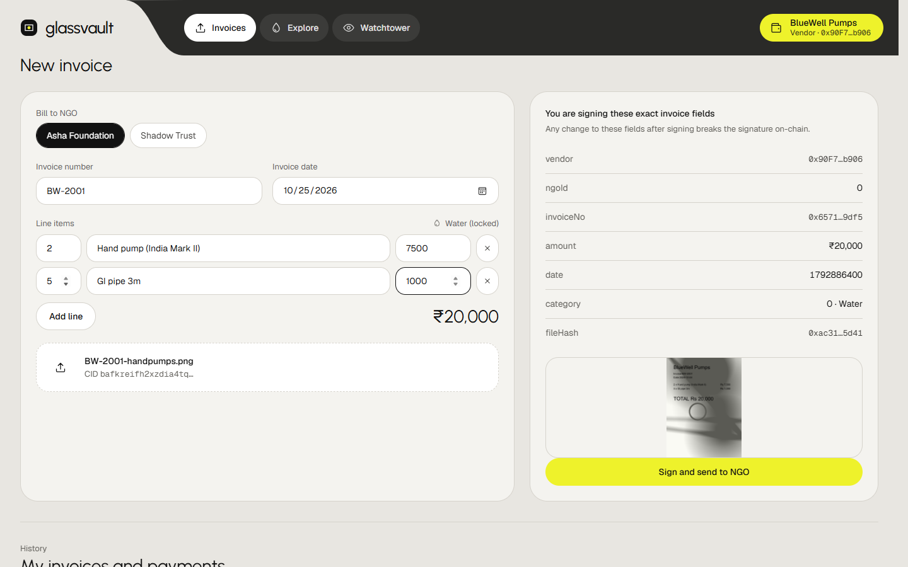

---
## Step 5 — Field partner issues 3 beneficiary QR cards — no names

*Story:* Sahyog, an independent field partner, registers 3 households in Wadgaon village who will receive the pumps.

**Login:** `field` / `Sahyog@Field26` · **Page:** Deliveries (field workspace) · **Upload:** `card-keys.txt (you fill it)`

**Do:**
1. Sign in as field.
2. Choose **Asha Foundation**. Batch label `Wadgaon hand-pump households`. Number of cards `3`.
3. Click **Issue cards**.
4. **Copy the 3 card keys** into `card-keys.txt` in this folder (they stand for the printed QR cards you would hand out). Then **Close**.

**You should see:** 3 cards with QR codes. On-chain only one Merkle-root fingerprint of the list is recorded, attested by the field partner.

**Why this step:** **Privacy protection**. Each card's key is generated in the browser and never uploaded. The chain stores only the Merkle root of the card list — no names, no phone numbers, no Aadhaar. Later each card proves *"I am on the list"* without revealing *which* person it is.

**Say to the judges:** “An independent partner makes the cards. Only a fingerprint of the list goes on-chain — no names.”

**PS point:** Privacy protection

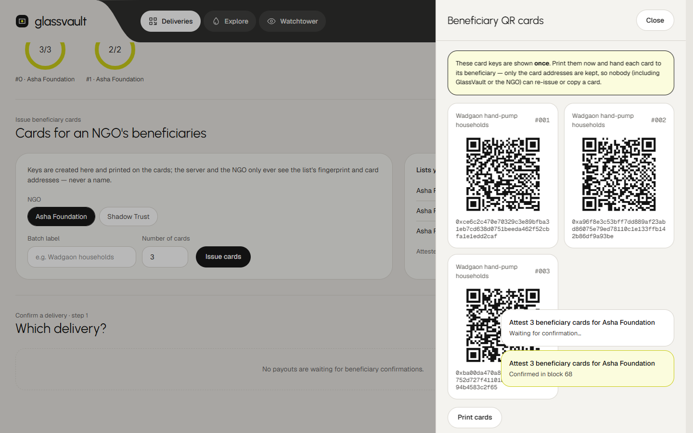

---
## Step 6 — Asha (NGO) requests the payout against that invoice

*Story:* Asha now wants to pay BlueWell from the escrowed Water donations.

**Login:** `asha` / `Asha@NGO2026` · **Page:** NGO console

**Do:**
1. Sign in as asha.
2. Click invoice **BW-2001**.
3. Choose the delivery list **Wadgaon hand-pump households**.
4. Look at the pre-checks — all green. Click **Request payout**.

**You should see:** A payout row with a countdown (the public challenge window). Status: *Requested*.

**Why this step:** Disbursement **conditions are enforced by the contract**, not by trust: category Water = donation's earmark, budget available, valid vendor signature, receipt never used before (nullifier), the field partner attested the beneficiary list, sane dates. If any fails, the transaction reverts. Note: the money goes from escrow **straight to the vendor**, never to the NGO's wallet.

**Say to the judges:** “Category, budget, signature, duplicate check, attested cards, dates — the contract checks all of it.”

**PS point:** Purpose-bound allocation · Verifiable expenditure · Double-counting (nullifier)

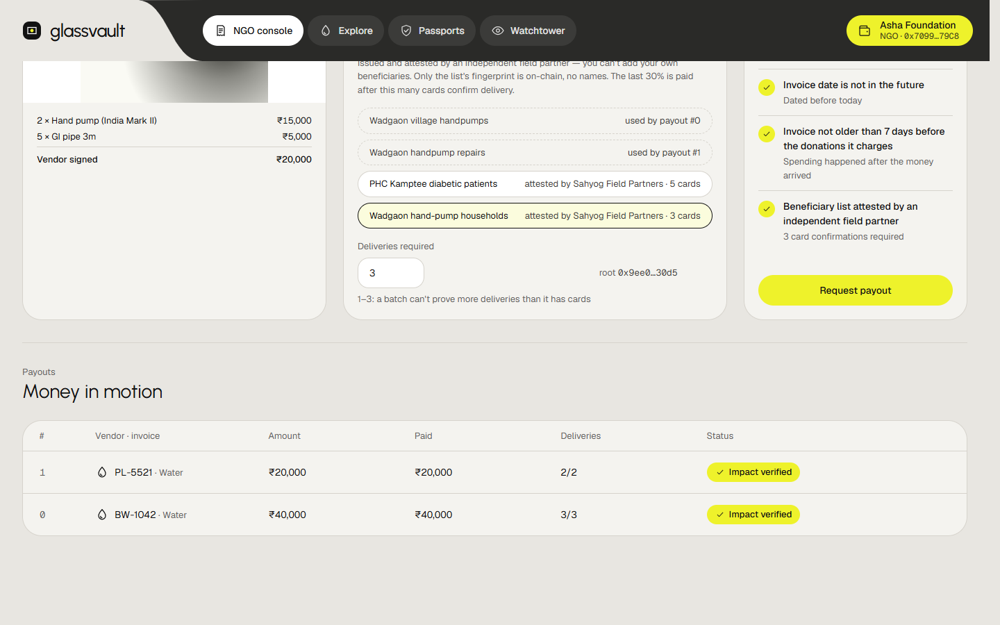

---
## Step 7 — Wait the 45-second challenge window, then release 70%

*Story:* Anyone in the world could object to this payout during the window.

**Login:** `asha` · **Page:** NGO console → the payout row

**Do:**
1. Wait for the countdown to finish (~45 s). Use the time to explain why.
2. Click **Release 70%**.

**You should see:** ₹14,000 goes to BlueWell. The remaining ₹6,000 stays locked until delivery is proven.

**Why this step:** The window lets watchers challenge with a bond *before* money leaves. Splitting 70/30 means the vendor is never fully paid until beneficiaries confirm delivery — the last 30% is the incentive to actually deliver.

**Say to the judges:** “Anyone could have challenged it in that window. Only now does 70% move.”

**PS point:** Purpose-bound allocation (disbursement conditions)

---
## Step 8 — Beneficiaries confirm delivery → final 30% → Priya sees the evaluation chain

*Story:* The field worker visits the 3 households; each scans its card on handover.

**Login:** `field`, then `priya` · **Page:** Deliveries → then My donations (Passport)

**Do:**
1. Sign in as field → **Deliveries** → click **Payout #…** (the BW-2001 payout).
2. In **Or paste the card key** paste card 1 from `card-keys.txt` → it shows *Card is on this payout's approved list.* → **Confirm handover on-chain**.
3. Wait until the button says **Confirm handover on-chain** again (it shows *Confirming…* while the transaction lands), then repeat for card 2 and card 3.
4. Sign in as priya → open her Water donation's Passport → scroll to **Probabilistic evaluation chain / Chain confidence**.

**You should see:** After the 3rd card: payout *Completed*, final 30% released, *Impact verified*. Priya's passport shows the journey (donation → escrow → invoice → payout → delivery) and a confidence % for each of the 4 stages.

**Why this step:** **Proof of delivery without identity**: each card signs *"delivered for payout #X"* (EIP-712) plus a Merkle proof of membership; the contract verifies it. The key never touches the chain. **Probabilistic evaluation chain** = PS's Inbound Donation → Escrow Condition → Cryptographic Impact Verification → Off-chain Invoice Proof, each stage a probability, multiplied into one score (e.g. 1 × 0.99 × 0.97 × 1 ≈ 96%).

**Say to the judges:** “Each card signs 'delivered' — only now is the last 30% paid. And here is how sure you can be, stage by stage.”

**PS point:** Privacy + proof of delivery · Probabilistic evaluation chain

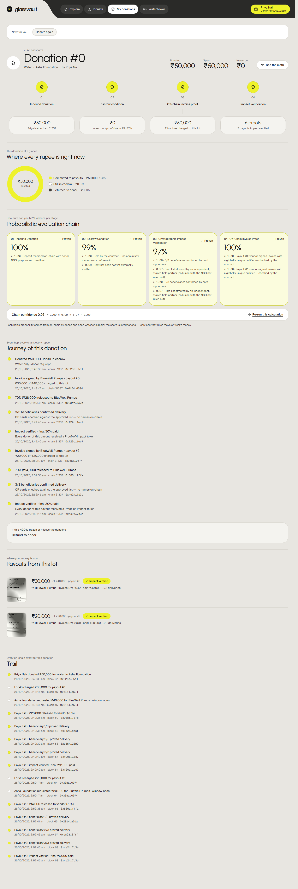

---
## Step 9 — Off-chain fiat: ETH → swap → bridge → rupees paid to a village shop

*Story:* Rahul gave 0.25 ETH. It was swapped, bridged, and finally spent *in cash rupees* by a local fiat agent.

**Login:** `paylink`, then anyone (signed out is fine) · **Page:** Vendor workspace → Passport of donation #7

**Do:**
1. Sign in as paylink — show the fiat agent screen (its invoices and rupee settlements).
2. Open **Explore** → donation **#7** (Rahul's), or go to `/passport/7` → read the **Journey**.

**You should see:** One line per hop: 0.25 ETH → swapped → ₹50,000 → bridged → PayLink invoice → 70% → ₹20,000 paid in rupees (bank UTR fingerprint) → delivered.

**Why this step:** The PS says money is *"supposedly spent off-chain via local fiat vendors"*. The fiat agent must post a signed **FiatSettlement** with the hash of the bank/UPI reference. The reference becomes a nullifier too — the same bank transfer can't back two payouts. If no settlement arrives before the deadline (90 s in the demo, days in production), the payout is flagged *unsettled*.

**Say to the judges:** “Every hop is a transaction — even the rupees paid in the village have a signed, fingerprinted record.”

**PS point:** Multi-hop + fiat off-ramp · Verifiable expenditure

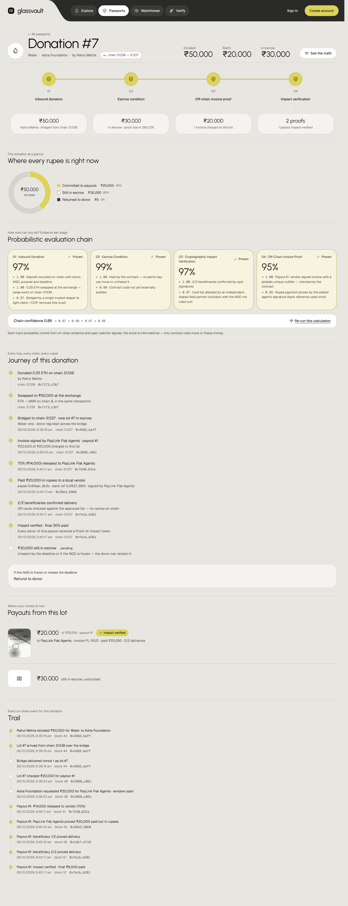

---
## Step 10 — THE ATTACK — Shadow Trust re-uses the same receipt as BW-2077

*Story:* Shadow Trust (adversarial NGO) and BlueWell take the *same* hand-pump photo, rescan it, give it a new number BW-2077, and bill another donor's money.

**Login:** `field`, `bluewell`, `shadow` · **Page:** Deliveries → Invoices → NGO console · **Upload:** `BW-2001-rescan-as-BW-2077.png`

**Do:**
1. field: issue **1 card** for **Shadow Trust**, label `Shadow 'beneficiaries'` → Close.
2. bluewell: bill **Shadow Trust**, number `BW-2077`, same 2 lines as before, attach **kit/BW-2001-rescan-as-BW-2077.png** → **Sign and send to NGO**.
3. shadow: NGO console → click **BW-2077** → pick `Shadow 'beneficiaries'` → **Request payout**.
4. Watch the payout: within seconds it turns **Disputed / Challenged**.

**You should see:** All on-chain checks pass (new number = new file hash), but the open watcher bot matches the image to BW-2001 and files a challenge with its own bond.

**Why this step:** This is **double-counting one piece of evidence**. A pure hash nullifier would miss a rescan, so the watcher also compares a *perceptual* hash (dHash: how the image looks, not its bytes). The challenge is a public on-chain action anyone can run — no central auditor.

**Say to the judges:** “Same photo, new number. Every on-chain check passes — but the open watcher matched the image and challenged it with its own money at stake.”

**PS point:** Double-counting · Detection without a central auditor

---
## Step 11 — Donors decide the dispute — not an auditor

*Story:* Navkiran's CSR money funds Shadow's payout, so Navkiran gets the vote.

**Login:** `navkiran` / `Navkiran@CSR26` · **Page:** Watchtower → Disputes

**Do:**
1. Sign in as navkiran → **Watchtower** → the dispute → **Uphold ·…**.
2. Wait for the vote window to end (countdown on the dispute, ~45 s) → **Resolve on-chain**.

**You should see:** Payout cancelled. Shadow's NGO bond and BlueWell's vendor stake are paid to the watcher who caught it.

**Why this step:** The **challenge court**: the donors whose rupees are at stake vote (weighted by their money). No admin key, no auditor. Lying is expensive: the cheaters lose their stakes; honest watchers earn them; a false challenger would lose its own bond.

**Say to the judges:** “No auditor: the donors whose money is at stake decided. The cheaters' bonds now belong to whoever caught them.”

**PS point:** Freeze/decide without a central auditor

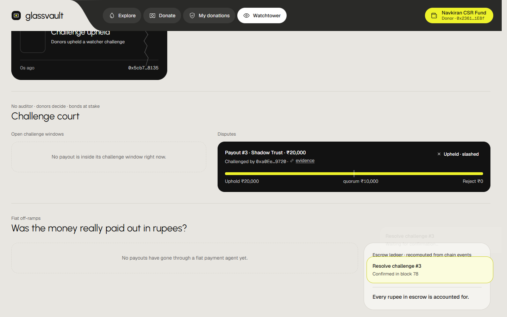

---
## Step 12 — Red team: duplicate + forged receipts → automatic FREEZE → money redirected

*Story:* Shadow keeps cheating: resubmits a duplicate and a forged signature (the 30% forged receipts).

**Login:** `watcher` / `Watch@Tower26` · **Page:** Watchtower → Red team, then Stuck money

**Do:**
1. Sign in as watcher → **Watchtower** → **Red team**.
2. Click **Run** on *Resubmit duplicate*. If not frozen yet, click **Understood** and **Run** *Forge signature*.
3. The red **Freeze Frame** appears: *Escrow frozen by contract*. Click **Understood**.
4. Go to **Stuck money** → **Redirect to Asha Foundation**.

**You should see:** Shadow Trust is frozen — no more payouts possible. Navkiran's unspent donation moves to its fallback NGO, Asha.

**Why this step:** The contract counts fraud flags (duplicate nullifier, invalid signature). **At 2 flags it freezes the NGO in the same transaction** — no human pressed a button. The dead-man switch then lets *anyone* move the stuck money to the donor's chosen fallback, so frozen money isn't lost.

**Say to the judges:** “Duplicate plus forgery — the contract froze Shadow Trust in the same transaction. Navkiran's unspent gift moves to Asha.”

**PS point:** Double-counting · Forged receipts · Freeze without a central auditor · Purpose-bound

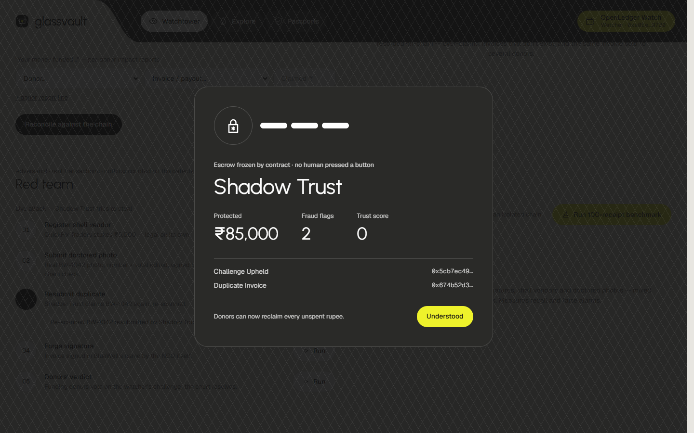

---
## Step 13 — Published report vs the chain — the Reconciler

*Story:* Shadow publishes a glossy report telling two different donors the same invoice was *their* impact.

**Login:** `watcher` · **Page:** Watchtower → Report reconciler

**Do:**
1. Click **Load example: double-counted report**.
2. Click **Reconcile against the chain**.

**You should see:** Over-claimed spending, over-attributed donors, *double-counted 200%*.

**Why this step:** **Discrepancy detection**: PS asks to flag *inconsistencies between published reports and recorded transactions*. The reconciler compares the NGO's claims (per category, per donor) to on-chain payouts and nullifiers.

**Say to the judges:** “The NGO told two donors the same invoice was theirs. The chain says otherwise: 200%.”

**PS point:** Discrepancy detection (reports vs chain) · Double-counting

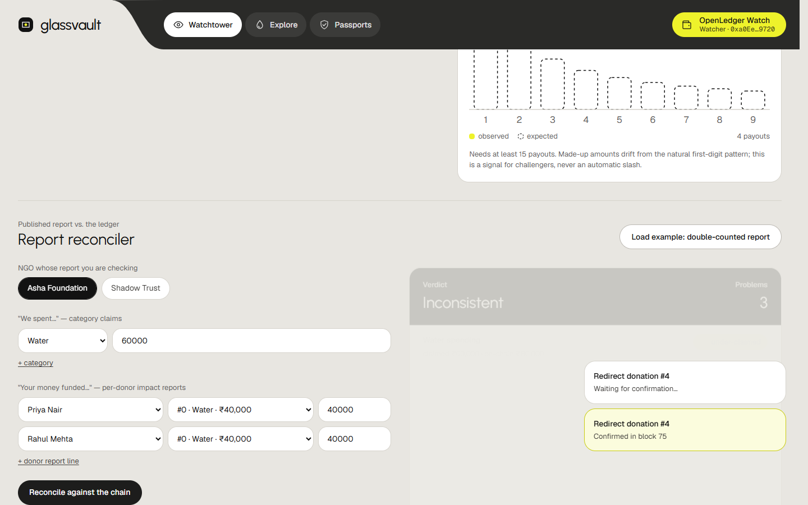

---
## Step 14 — Proof at scale: 100 receipts, 30% forged — and the books balance

*Story:* The PS adversary forges 30% of receipts. We prove detection on 100 receipts.

**Login:** `watcher` + a terminal · **Page:** Watchtower → benchmark; terminal in the glassvault folder

**Do:**
1. Click **Run 100-receipt benchmark** (≈25 s).
2. Point at the escrow ledger: gap ₹0.
3. In a terminal: `npm run acceptance` → *12/12 requirements met*.

**You should see:** 30/30 fraudulent caught, 0/70 false alarms. Every rupee in = every rupee locked + paid + refunded.

**Why this step:** One demo case can be luck; 100 mixed receipts (duplicates, altered amounts, forged signatures, shell vendors, doctored photos) show the detectors work together. The acceptance script runs every PS requirement on real contract execution.

**Say to the judges:** “100 receipts, 30% forged: 30 of 30 caught, zero false alarms. And every requirement is checked automatically.”

**PS point:** Forged receipts · Unexplained transfers · All 12 PS checks

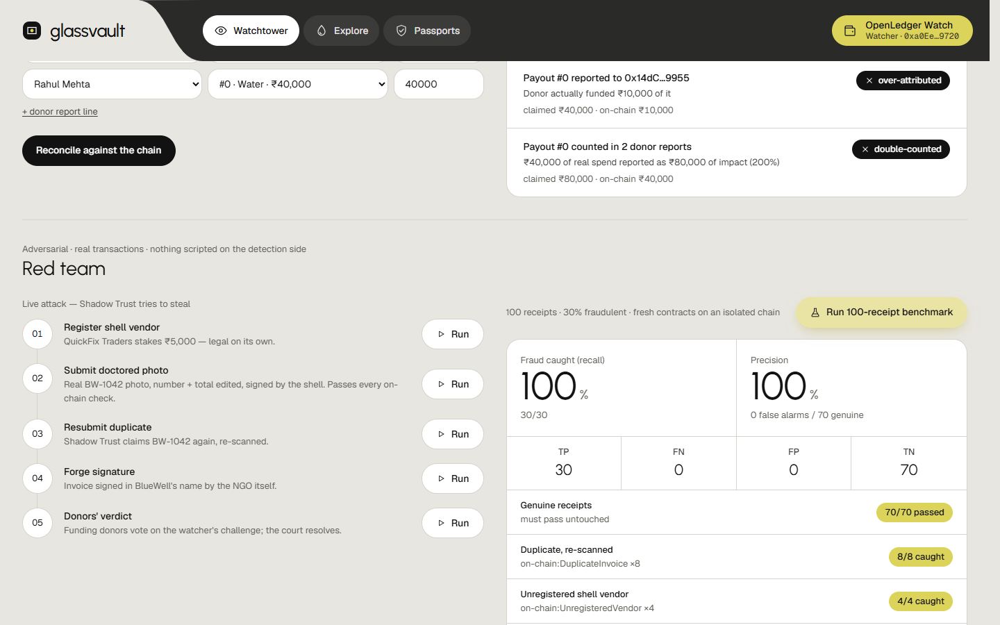

---
## Step 15 — Don't trust us — verify it yourself (trustless check)

*Story:* A judge asks: "Your server shows all this. What if your server lies?" Hand them the Verify page.

**Login:** Anyone — no login (ideally the judge, on their own phone or laptop) · **Page:** Verify (top menu) · `/verify`

**Do:**
1. Open **Verify**. Point at the 4 facts on top: source = blockchain node, contract address, chain id, **live block number** ticking.
2. Drop **kit/BW-2001-handpumps.png** → *This exact file backs payout #… — Completed*, with amount, vendor, deliveries 3/3 and the invoice nullifier.
3. Drop **kit/BW-2001-rescan-as-BW-2077.png** → it backs the **Cancelled** payout of Shadow Trust (the fraud from Step 10).
4. Optional: drop any other image → *No payment on the chain is backed by this file*.
5. Section 2: type the payout number → **Read it from the chain** → its full event history with block numbers and transaction hashes.
6. Section 3: Shadow Trust shows **Frozen by contract**.

**You should see:** Every verdict is computed in the browser from the chain node: the file is hashed locally (keccak-256) and compared with the fingerprint the contract stored.

**Why this step:** The PS starts with: donors have *no independently verifiable way* to check. This page is that way. Our database, indexer and API are not used for any answer. The server is only used to *locate* receipt files for the look-alike check, and each file is re-hashed in the browser and must match the contract — so a lying server could hide a file but never fake one. If GlassVault disappeared, the checks still work against the chain.

**Say to the judges:** “Don't trust our dashboard. Drop the receipt here: your browser hashes it and asks the blockchain directly. No GlassVault server is involved in the answer.”

**PS point:** Independent verification · Verifiable expenditure · Double-counting · Freeze without an auditor

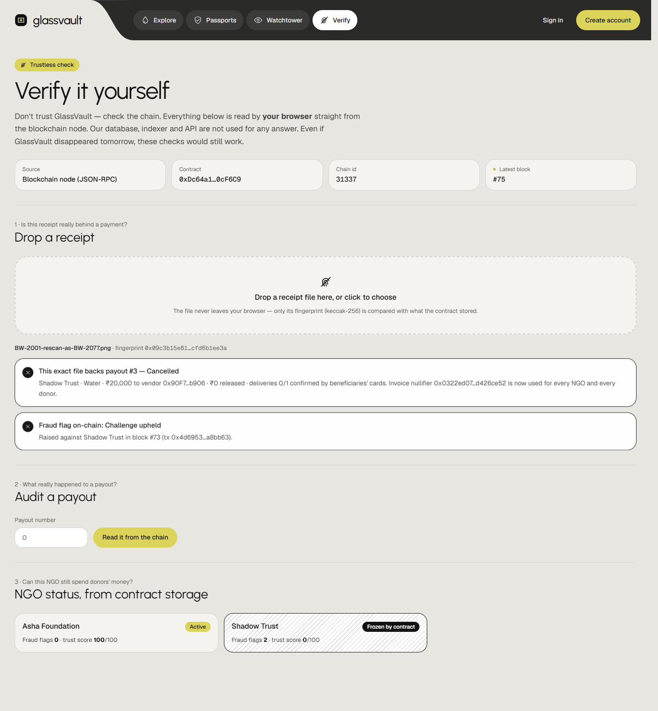

---
## PS 4.2 coverage
| Requirement | Steps |
|---|---|
| Purpose-bound allocation | 2, 3, 6, 7, 12 |
| Verifiable expenditure records (on-chain ↔ off-chain receipts) | 4, 6, 9, 15 |
| Privacy protection + proof of delivery | 5, 8 |
| Discrepancy detection (transfers, categories, reports vs chain) | 13, 14 |
| Multi-hop: swapped, bridged, off-chain fiat | 2, 9 |
| Adversary double-counts one piece of evidence | 10, 12, 13, 15 |
| Adversary forges 30% of receipts | 12, 14 |
| Detect + freeze escrow without a central auditor | 10, 11, 12, 15 |
| Independently verifiable (no trust in GlassVault) | 15 |
| Probabilistic evaluation chain | 8 |

## Closing line
> “Money moves only when proof moves. Proof can't be forged without the vendor's key, can't be reused because of nullifiers, and can't expose beneficiaries because only fingerprints go on-chain. And if an NGO lies, it doesn't just get caught — it pays whoever caught it.”

## If something goes wrong
- **Sign-in / sign-up fails** → `npm run stop` then `npm run start:prod`.
- **"Release 70%" not there** → the 45 s window hasn't ended; watch the countdown.
- **"Resolve on-chain" not there** → the vote window hasn't ended.
- **MetaMask nonce error after a restart** → MetaMask → Settings → Advanced → *Clear activity tab data*.
- **Public link dead** → run `npm run share` again; it prints a new link.
- **Live demo impossible** → show `demo/shots/` and the logs in `test-evidence/`; `npm run acceptance` runs without the UI.
- **Replay the whole drill automatically** → `node e2e/demo-rehearsal.js` (then reset again).

## Test evidence (all through the public link, 26 Oct 2026)
| Test | Result |
|---|---|
| Full judges drill (`drill-run.log`) | 15/15 steps ✔, 9/9 PS requirements |
| PS acceptance (`acceptance.log`) | 12/12 requirements met |
| MetaMask sign-in, sign-up, donate, swap+bridge (`metamask.log`) | ✔ |
| Smoke, tour, confidence, SIWE, signup, multihop, flow, attack, perf | ✔ each (see logs) |
