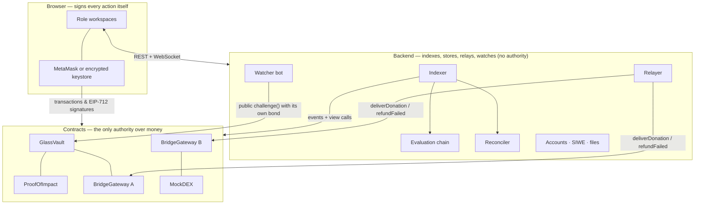
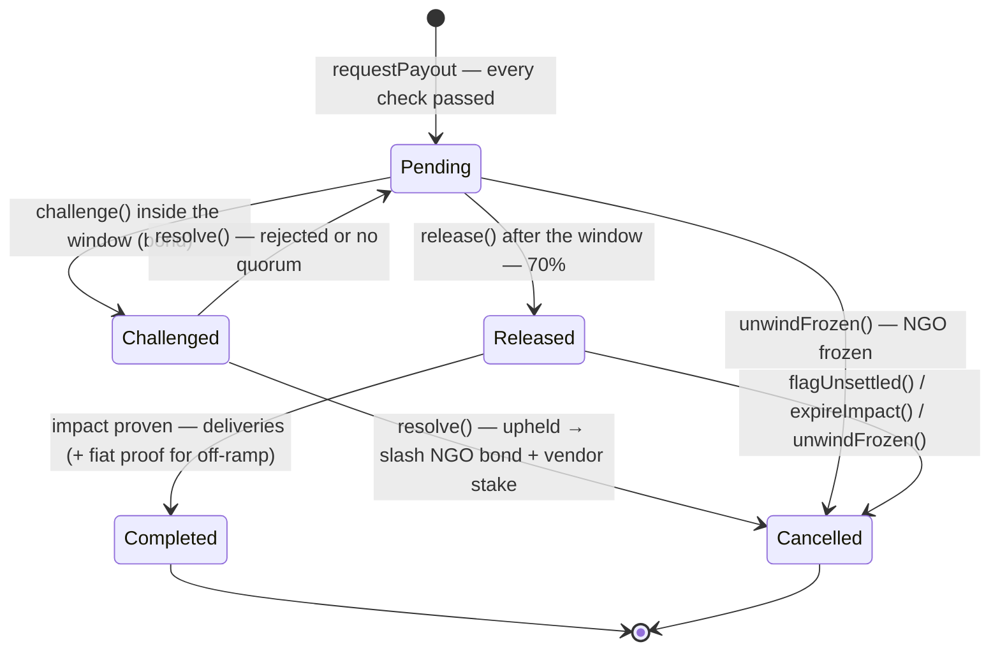

# Architecture

GlassVault is three layers with one rule: **the chain decides, everything else serves it.**

## Contracts

| Contract | Chain | Responsibility |
|---|---|---|
| `GlassVault` | A | Lots, payouts, invoice and fiat proofs, deliveries, challenge court, fraud flags and freeze, refunds, dead-man switch, registries for NGOs / vendors / off-ramp agents / field partners |
| `ProofOfImpact` | A | Soulbound ERC-721 minted to each funding donor when a payout's impact is proven |
| `BridgeGateway` | A and B | Source: lock (optionally swap first) and emit the donation tag; destination: deliver once per `(sourceChain, nonce)`; refund donations the destination rejects |
| `MockDEX` | A and B | Fixed-rate ETH → dINR swap for the multi-hop example (a Uniswap pool in production) |
| `DINR` | A and B | Rupee stablecoin used inside escrow |

### Payout lifecycle

`requestPayout` never moves money; it **reserves** it from donor lots. A failed check is either a
**fraud flag** (duplicate invoice, forged signature, unregistered vendor, out of category, future
date — counts toward the freeze), a **discrepancy** (over budget, amount mismatch, invoice long
before the donation — recorded, not counted, because stale balances cause them honestly), or a
plain revert (expired lot, unattested card list, too many deliveries).

### Parameters

| Constant | Value | Meaning |
|---|---|---|
| `NGO_BOND` | ₹10,000 | slashed to whoever proves fraud |
| `VENDOR_STAKE` | ₹5,000 | vendors and off-ramp agents |
| `FIELD_STAKE` | ₹2,000 | field partners |
| `CHALLENGE_BOND` | ₹500 | posted by a challenger; returned with the reward if upheld |
| `FRAUD_THRESHOLD` | 2 | fraud flags that freeze an NGO |
| `INVOICE_RELEASE_BPS` | 7,000 | 70% on invoice proof, 30% on impact proof |
| `MAX_SHARES` | 16 | lots one payout may charge (bounds loops under the gas limit) |
| `INVOICE_GRACE` | 7 days | how long before a donation an invoice may be dated |
| `challengeWindow` | 45 s local (deploy-time) | public dispute window; also the vote period |
| fiat deadline / impact deadline | 2× / 4× window after release | then anyone may flag / expire |

### Invariants

1. **Escrow balance** — the vault's dINR balance always equals
   Σ lot.remaining + Σ (amount − paid) of open payouts + Σ NGO bonds + Σ vendor stakes
   + Σ field-partner stakes + open challenge bonds. The indexer recomputes it on every block and
   shows the gap publicly; the acceptance suite asserts it is zero.
2. **No admin path** — no function lets any address move, freeze or unfreeze funds outside these
   rules; the acceptance suite checks the ABI for owner / pause / withdraw / unfreeze functions.
3. **One proof, one use** — invoice nullifiers, bank-reference nullifiers, card-list roots and
   delivery nullifiers are each single-use and global.
4. **Money never gets stuck** — every reserved rupee has an exit: release, unwind, expiry, refund
   or redirect, each callable by anyone once its condition holds.

## Backend

| Module | Role |
|---|---|
| `indexer.js` | Polls both chains, decodes events, rebuilds a state snapshot from contract views, reconstructs multi-hop origins (swap → send → deliver), computes the escrow ledger and annotates the evaluation chain; pushes state over WebSocket |
| `watcher.js` | Open-source bot: perceptual (dHash) near-duplicate receipts and future dates → bonded `challenge()`; Benford's-law drift as a published signal only |
| `relayer.js` | Chain B `DonationSent` → chain A `deliverDonation`; simulates first and refunds on chain B if chain A would refuse |
| `confidence.js` | Pure, deterministic probabilistic evaluation chain (re-runnable from public state) |
| `reconcile.js` | Compares an NGO's published report with the chain: over-claims, over-attribution, double counting |
| `auth.js` / `accounts.js` | Password accounts (scrypt, hashed session tokens, HttpOnly cookies), Sign-In with Ethereum (EIP-4361, single-use nonces, domain allowlist), local faucet |
| `server.js` / `store.js` | REST API, content-addressed file store (IPFS CIDs; type sniffed from bytes; sandboxed serving) |

## Frontend

React 19 with a selector-based store (`useSyncExternalStore`): components subscribe only to the keys
they read. Every write is signed in the browser — by MetaMask (EIP-6963 discovery, automatic chain
add/switch) or by a keystore wallet that is encrypted with the user's password and unlocked on
demand. Pages are lazy chunks; motion is short and compositor-only.

## Trust boundaries

| Component | Trusted for | Not trusted for |
|---|---|---|
| Contracts | everything about money | — |
| Backend | availability of indexes and files | deciding fraud, holding keys, moving funds |
| Bridge relayer | delivering a locked donation once | (replays are blocked on-chain) |
| Watcher bot | bringing evidence | deciding — donors vote, the contract resolves |
| Field partner | issuing cards to real people | (staked; collusion is a documented limitation) |
| Fiat agent | signing a true bank reference | (staked; reuse and silence are caught on-chain) |

## Profiles and ports

`scripts/dev.mjs` runs the whole stack. The default profile uses ports 8545 / 8546 (chains), 4000
(API) and 5173 (web). `--profile=<name>` offsets every port by 10,000 and keeps state under
`.gv/<name>`, so `npm run e2e:full` never touches a developer's running session.
